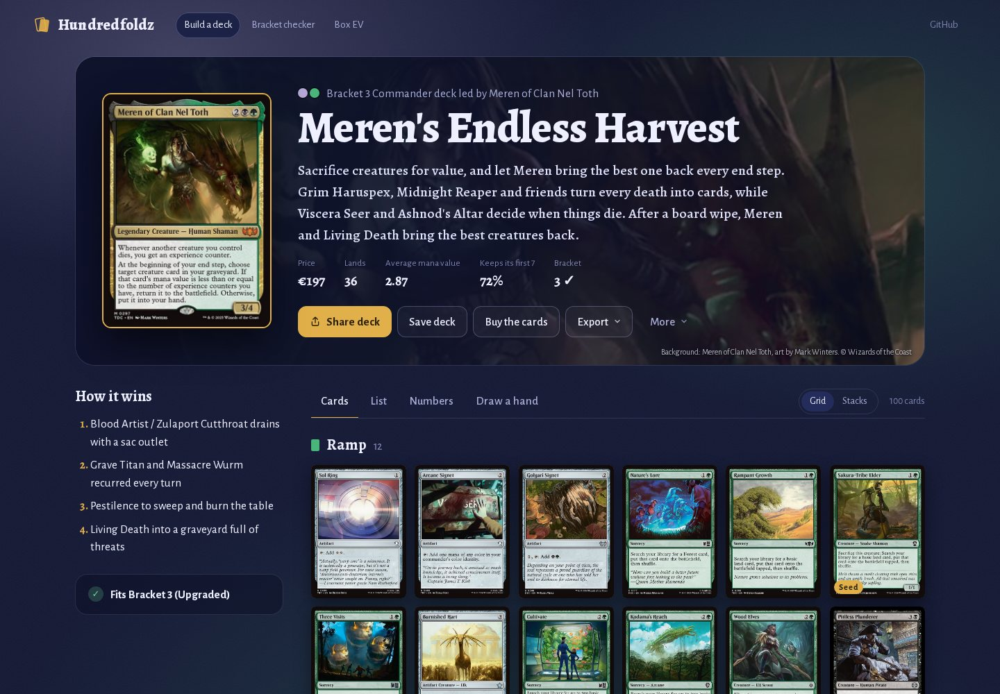
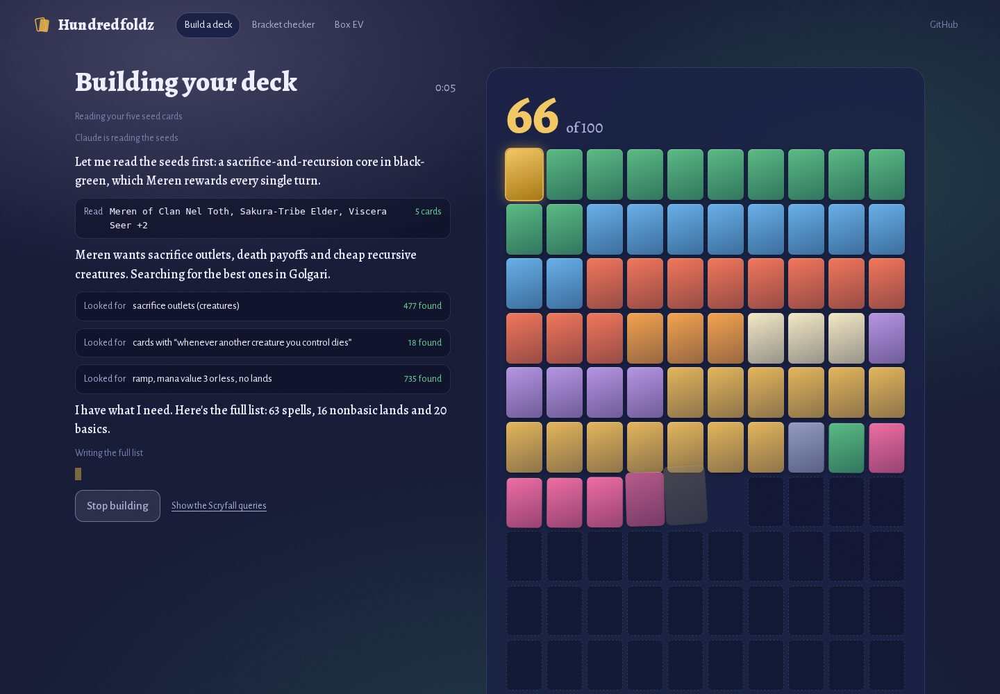
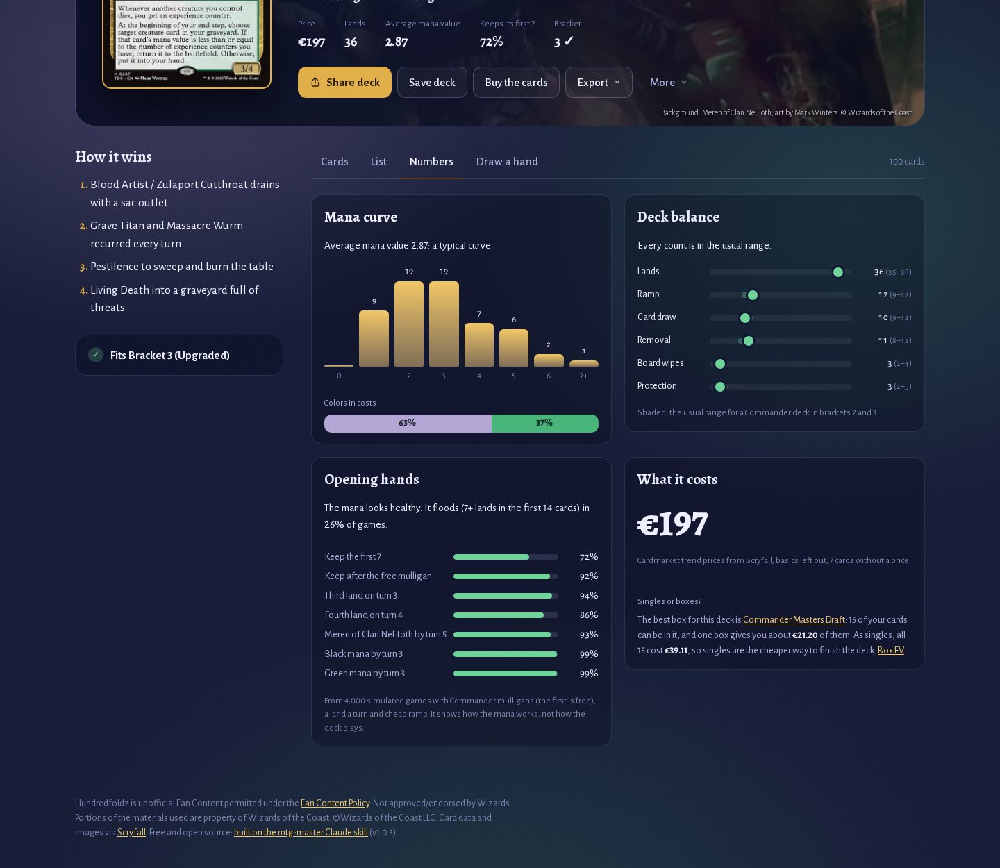
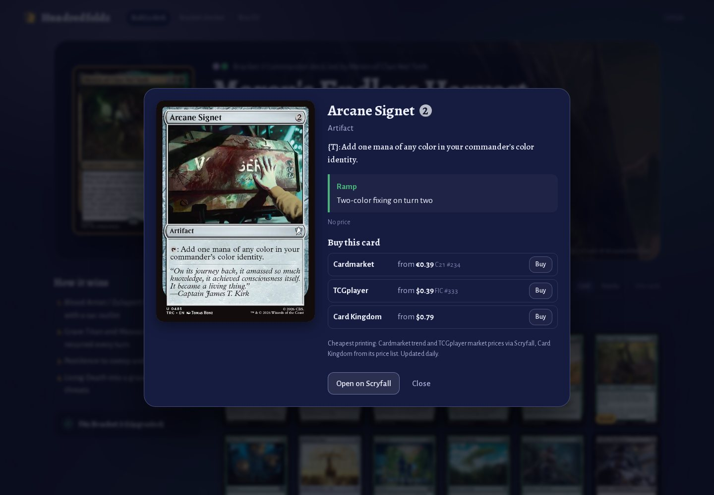
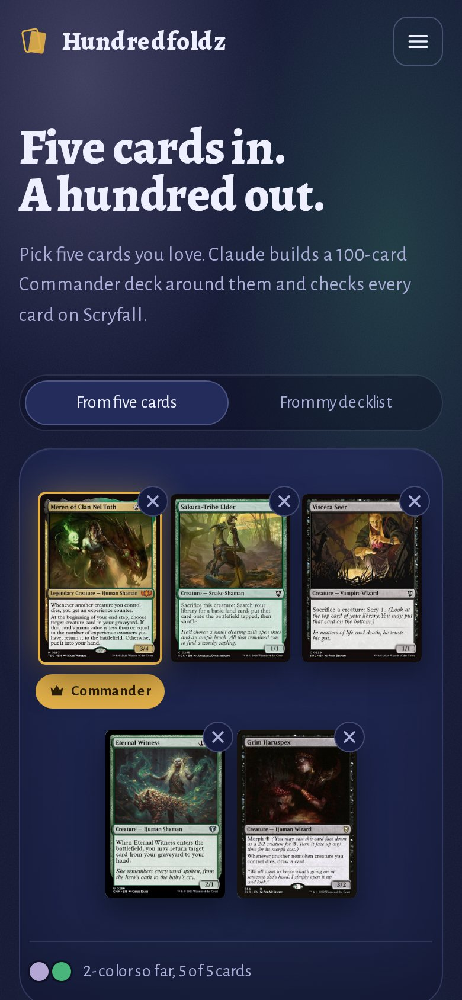
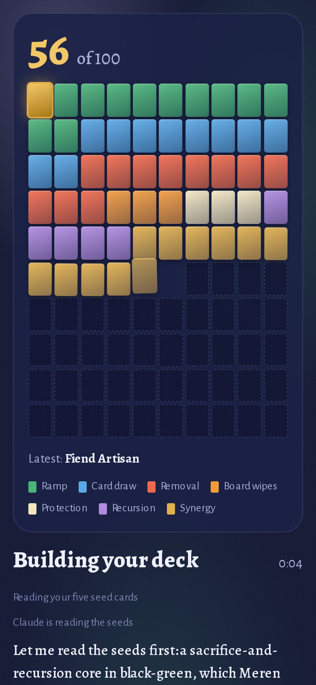
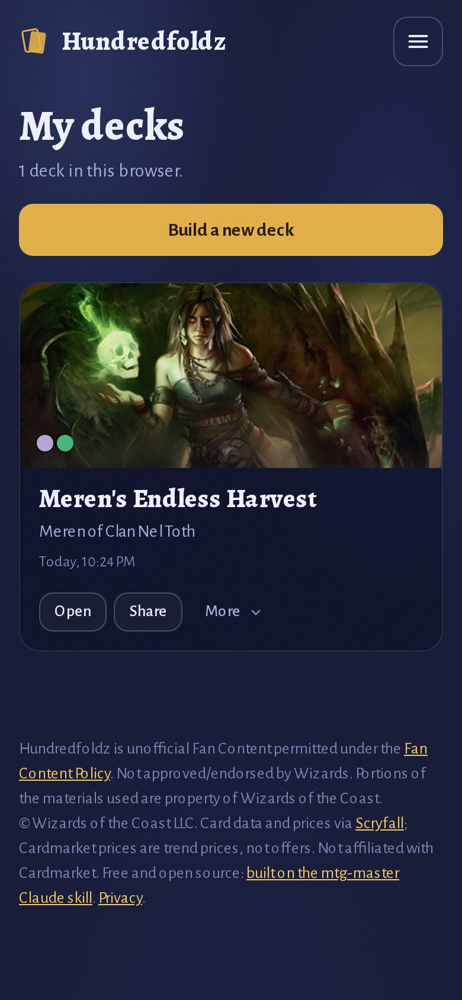
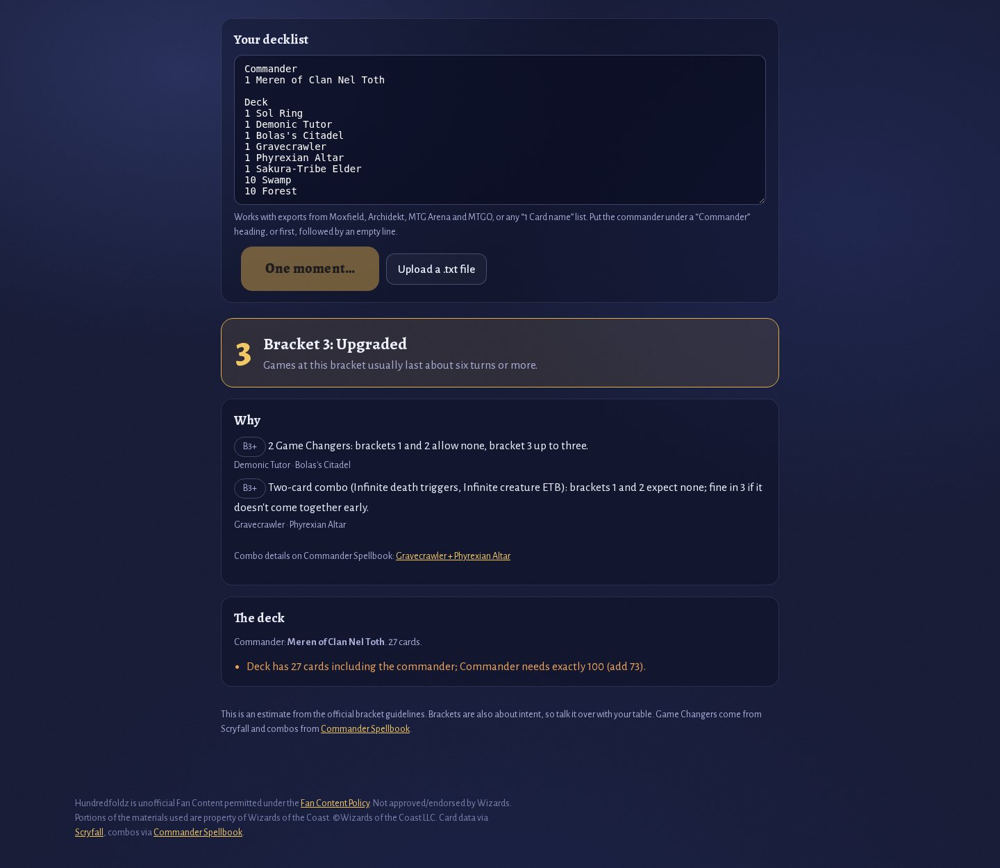
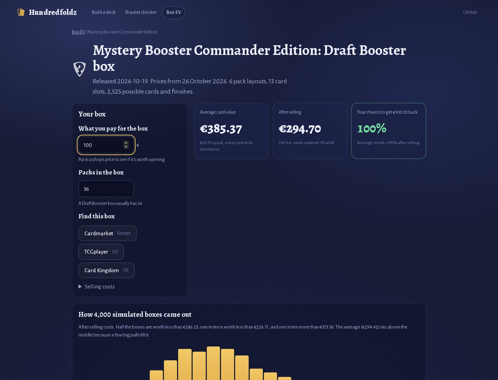

<div align="center">


# Hundredfoldz

**Five cards in. A hundred out.**

Pick five Magic cards you love and Claude builds a full, legal 100-card Commander deck around them,<br>
checked card by card on Scryfall. Built on [MTG Master](https://github.com/M-Sahin/mtg-master), a Claude Skill for Magic: The Gathering.

[](https://github.com/M-Sahin/hundredfoldz/actions/workflows/ci.yml)
[](LICENSE)

**[Try Hundredfoldz](https://hundredfoldz.app)** · [Host your own](docs/self-hosting.md) · [Features in detail](docs/features.md) · [Development](docs/development.md)

<br>



</div>

## Pick five cards. Watch Claude build the other 95.

<table>
<tr>
<td width="50%"></td>
<td width="50%"></td>
</tr>
<tr>
<td><b>Five cards, a bracket, a budget.</b> Any five Commander-legal cards, a commander among them or not. Claude picks the commander if you don't.</td>
<td><b>Every step, live.</b> What Claude is looking for, every Scryfall search, and the list filling a 10×10 grid by role. You can leave the page: the build keeps going.</td>
</tr>
</table>

- **Checked, not guessed.** Every card is looked up on Scryfall. The server checks the deck before you see it: 100 cards, singleton, color identity, the bracket's Game Changers, mass land denial and extra turns, and early two-card combos from Commander Spellbook. A deck that fails goes back to Claude with the problems, and Claude fixes them.
- **The numbers that matter.** A mana curve and deck balance against the usual Commander counts. How often the mana works, from 4,000 simulated opening hands. What the deck costs, and whether any booster box is a cheaper way to get it (it almost never is).
- **Your deck, your way.** Complete a half-built deck to 100, or get up to 10 suggested upgrades for a finished one. Build only from cards you own. Set limits on creatures, lands, ramp, draw, removal, wipes or average mana value.
- **Take it anywhere.** Share a link, copy the list for Moxfield, Archidekt or MTG Arena, or open the whole list in a shop's cart. Tap any card for its price at Cardmarket, TCGplayer and Card Kingdom.
- **Your decks, when you want them.** Press Save deck to keep a deck in My decks: in your browser, or on every device with a free account (log in with an email link, no password). Your Claude API key can live in your account too.
- **Free to use.** Three free builds on Claude Haiku. After that, or for Sonnet and Opus, bring your own Claude API key: you pay Anthropic directly, about 25 cents a deck on Sonnet.

<table>
<tr>
<td></td>
<td></td>
</tr>
<tr>
<td><b>Verdicts first.</b> Each panel says what it found before it shows the chart.</td>
<td><b>Why it's in the deck.</b> Every card says what it does for the plan, and where to buy it.</td>
</tr>
</table>

## Made for your phone

<table>
<tr>
<td width="25%"></td>
<td width="25%"></td>
<td width="25%"></td>
<td width="25%"></td>
</tr>
</table>

Put your phone away mid-build and the deck is still there when you come back. On a phone the build screen follows Claude, and stacked cards pop out with a tap.

## Free tools, no key needed

<table>
<tr>
<td width="50%"></td>
<td width="50%"></td>
</tr>
<tr>
<td><b><a href="https://hundredfoldz.app/bracket">Bracket checker</a>.</b> Paste any decklist and get the lowest bracket it fits, the cards that decide it, and a legality check.</td>
<td><b><a href="https://hundredfoldz.app/ev">Box EV</a>.</b> What every booster box since 2020 is worth on average, and your chance of getting your money back, from 4,000 simulated boxes with daily prices.</td>
</tr>
</table>

## Built on MTG Master

Claude builds every deck with **[MTG Master](https://github.com/M-Sahin/mtg-master)**, a Claude Skill that turns Claude into a pro-level Magic player, rules judge and deckbuilder. Its main rule is *verify, don't recall*: card text, legality, brackets and prices come from Scryfall and Wizards, not from the model's memory. Hundredfoldz gives the skill's lookups to Claude as tools, and the server checks the deck the way the skill's `deckcheck.py` does.

The skill works on its own too, in the Claude apps and in Claude Code: see [its README](https://github.com/M-Sahin/mtg-master#install-the-skill). This app pins a skill release in `package.json` and copies it in with `npm run sync-skill` ([how it works](docs/development.md#how-it-uses-the-skill)).

## Host your own

Hundredfoldz is free and open source. Deploy your own copy in one click: visitors build with their own Claude API key, so the site itself needs no key. With a key of your own you can also give every visitor a few free builds (`FREE_BUILDS`).

[](https://vercel.com/new/clone?repository-url=https%3A%2F%2Fgithub.com%2FM-Sahin%2Fhundredfoldz)

Docker and plain Node.js work too. [docs/self-hosting.md](docs/self-hosting.md) has every option: environment variables, accounts with Supabase, free builds, saved keys, the bot check and the Box EV data.

## Development

```bash
npm install
npm run dev      # http://localhost:3000, with your own key or the free demo
npm test         # unit tests, no network or key needed
```

Next.js 16 (App Router), React 19 and plain CSS, with no SDKs. CI builds the app, runs the tests, and drives a real browser through every screen on desktop and on a phone, including a sweep for anything that runs off a 360px screen. See [docs/development.md](docs/development.md) for the engine, the evals and the layout, and [CONTRIBUTING.md](CONTRIBUTING.md) for how to help.

## Credits and disclaimer

Card data and images come from the [Scryfall API](https://scryfall.com/docs/api). Combos come from [Commander Spellbook](https://commanderspellbook.com), booster contents from [taw/magic-sealed-data](https://github.com/taw/magic-sealed-data) and [MTGJSON](https://mtgjson.com). The mana-source numbers are based on Frank Karsten's published analyses.

Hundredfoldz is unofficial Fan Content permitted under the [Fan Content Policy](https://company.wizards.com/en/legal/fancontentpolicy). Not approved/endorsed by Wizards. Portions of the materials used are property of Wizards of the Coast. ©Wizards of the Coast LLC. It isn't affiliated with Scryfall. Magic: The Gathering is a trademark of Wizards of the Coast LLC.

## Support

Issues and pull requests are welcome: see [CONTRIBUTING.md](CONTRIBUTING.md), and [SECURITY.md](SECURITY.md) for reporting security problems. If Hundredfoldz is useful to you, you can [buy me a coffee on Ko-fi](https://ko-fi.com/msahin). It's free either way.

## License

[MIT](LICENSE) © 2026 Murat Sahin
